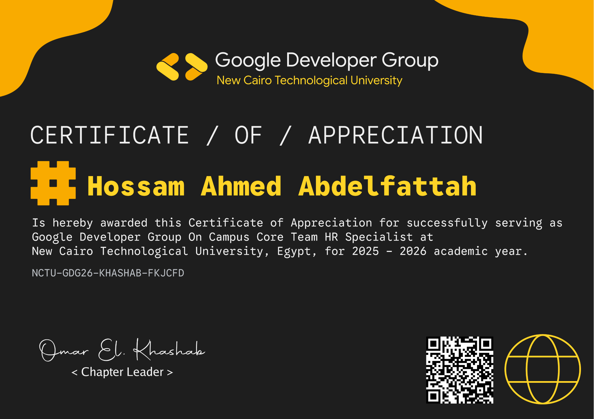
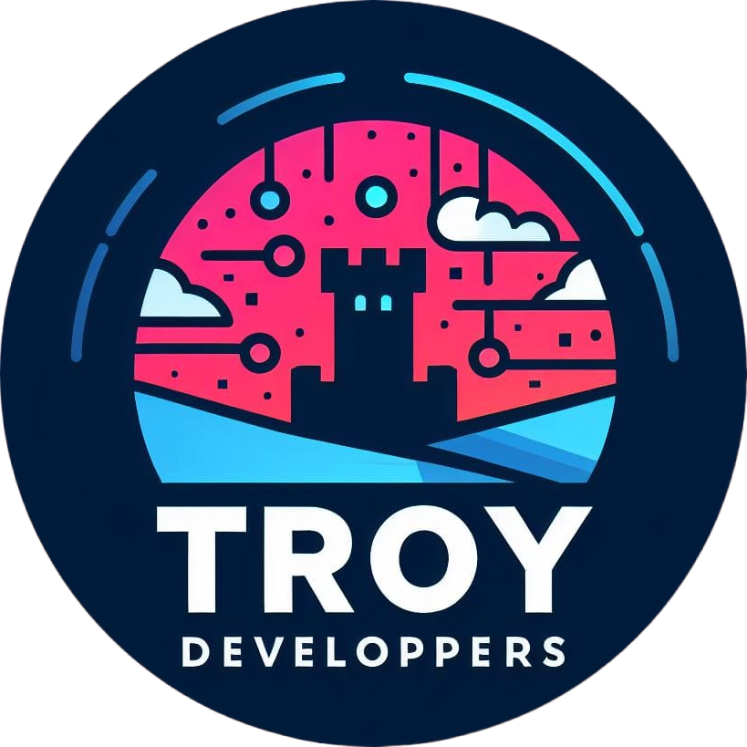

<table>
  <tr>
    <td width="150" valign="middle" align="center">
      
    </td>
    <td valign="middle">
      <h1>Hossam Ahmed (<code>@HossamAhmedSoft</code>)</h1>
      
<strong>Software Developer | Backend & Full-Stack Engineering | Embedded Systems & AI Enthusiast</strong>

      
📍 Cairo, Egypt | 💻 ICT Year 2, New Cairo Technological University (NCTU) 
      🔗 <a href="https://github.com/HossamAhmedSoft">GitHub Profile</a> | 🌐 <a href="https://github.com/HossamAhmedSoft/portfolio-website">Interactive Portfolio Website</a> | ✉️ Contact: <code>Kabtinhosa@yahoo.com</code>

    </td>
  </tr>
</table>

---

## 👋 About Me

I am a software engineer focused on building robust, well-architected systems across **Full-Stack Web**, **Enterprise APIs**, **Systems Programming**, **Applied Cryptography**, and **Embedded Robotics**. My work spans production Next.js platforms, Spring Boot microservices, high-performance C++ CLI applications, and hardware IoT firmware.

I prioritize clean architecture, automated testing, end-to-end type safety, and engineering discipline.

---

## 🛠️ Verified Technical Stack

- **Languages:** TypeScript / JavaScript (ES6+), Java (JDK 17, 21 & 25), C++ (C++17), Python 3, Embedded C / Arduino, SQL
- **Frontend & Web:** Next.js (App Router), React, Tailwind CSS, Radix UI, HTML5 / CSS3, Progressive Web Apps (PWA)
- **Backend & APIs:** Spring Boot 3 & 4, Node.js, Express, RESTful API Design, JWT Authentication, Spring Security 6
- **Databases & Cloud:** PostgreSQL, Supabase, Oracle Database, HikariCP, MySQL, Vercel
- **Desktop & Systems:** Java Swing (FlatLaf), Python Tkinter, Visual Studio (MSVC), Serial Communication, WebSockets
- **Embedded & Hardware:** Arduino Uno, Mega 2560, ESP32-CAM, Ultrasonic & Infrared Sensors, HD44780 LCD & Keypads
- **Testing & Tooling:** Pytest / Unittest, JUnit 5, Git, GitHub Actions, ESLint, TypeScript Strict Mode

---

## 👥 Community Experience

### Core Team HR Specialist — GDG NCTU
- **Organization:** Google Developer Group on Campus, New Cairo Technological University (GDG NCTU)
- **Role:** Core Team HR Specialist
- **Team:** Community & Membership Committee
- **Location:** New Cairo Technological University, Egypt
- **Academic Year:** 2025–2026
- **Duration:** Across two sessions

> *“Contributed to HR and community operations at GDG NCTU, supporting member engagement, communication, and community activities across two sessions.”*

This operational experience directly motivated the engineering of the automated **[GDG NCTU Operations & HR Platform](https://github.com/HossamAhmedSoft/hr-management-platform)** (Next.js 14, TypeScript, Supabase, 17 operational governance modules).

---

## 🏆 Certifications & Recognition

### Technical Certifications

#### Oracle Academy
- [Database Programming with SQL](certificates/oracle-database-programming-sql.jpg) — December 27, 2022 *(Course Final Exam Award)*
- [Database Design](certificates/oracle-database-design.jpg) — December 27, 2022 *(Course Final Exam Award)*
- [Database Foundations](certificates/oracle-database-foundations.jpg) — December 27, 2022 *(Course Final Exam Award)*
- [Java Programming](certificates/oracle-java-programming.jpg) — March 13, 2023 *(Course Final Exam Award)*
- [Java Fundamentals](certificates/oracle-java-fundamentals.jpg) — March 24, 2022 *(Course Final Exam Award)*
- [Java Foundations](certificates/oracle-java-foundations.jpg) — March 25, 2022 *(Course Final Exam Award)*

#### Microsoft
- [Microsoft Technology Associate (MTA): Introduction to Programming Using Java](certificates/microsoft-mta-java.jpg) — April 15, 2022 *(Industry Certification — Certiport: `PEaA-uSHc`)*

#### Competitions & Robotics
- [RoboCup MICA Egypt 2023](certificates/robocup-mica-egypt-2023.jpg) — Participation in the Line Follower Robot competition.

> 📁 *Complete technical credential details and high-resolution assets are indexed in the [certificates directory](certificates/README.md).*

### Community Recognition & Participation
- **[Certificate of Appreciation — GDG NCTU](assets/gdg-nctu/hr-specialist-certificate.png):** Awarded for successfully serving as Google Developer Group on Campus Core Team HR Specialist at New Cairo Technological University, Egypt (Academic Year 2025–2026, Verification Code: `NCTU-GDG26-KHASHAB-FKJCFD`).
- **[GDG NCTU Team Introduction Graphic](assets/gdg-nctu/team-introduction.jpg):** Community & Membership Committee — Human Resource Specialist.
- **[GDG NCTU Season 1 Finale Graphic](assets/gdg-nctu/season-1-finale.jpg):** Celebrating a season of learning, building, and growing with the community.

  

---

## 🚀 Featured Engineering Projects

### 1. [Troy FireBot — Autonomous IoT Firefighting Robot](https://github.com/HossamAhmedSoft/arduino-robotics-and-embedded-systems)

> **Team:** Troy Developers | **Stack:** Arduino, ESP32-CAM, C++17, Node.js, WebSockets | **Status:** Tested & Operational
- Autonomous robotic firefighting platform combining embedded sensor triangulation (5-channel flame array, MQ-2 gas sensor), dual L298N motor drivers, and browser-based WebSocket telemetry control room.
- Engineered by the Troy Developers team; demonstrated and tested at RoboCup MICA Egypt 2023.

### 2. [GDG NCTU Operations & HR Platform](https://github.com/HossamAhmedSoft/hr-management-platform)
> **Stack:** Next.js 14, TypeScript, Tailwind CSS, Supabase, Radix UI | **Status:** Production Deployed
- Centralized human resources and member performance platform governing 17 operational modules for Google Developer Groups (GDG) on Campus NCTU.
- Features multi-role RBAC, individual points ledger isolation, smart reminders, automated PDF report generation, and Egyptian calendar compliance.
- 100% strict TypeScript verified; full bilingual internationalization (English & Arabic).

### 3. [Enterprise Employee Management REST API](https://github.com/HossamAhmedSoft/employee-management-api)
> **Stack:** Spring Boot 3, Java 21, Spring Security 6, JWT, JPA / Hibernate, Oracle
- Production-grade REST backend for organizational employee and department governance.
- Implements stateless JWT authentication, role-based route security (`ROLE_ADMIN`, `ROLE_USER`), HikariCP connection pooling, and leave request lifecycle tracking.
- Validated with Apache Maven (`mvnw test-compile` clean build on Java 21 LTS).

### 4. [Classical Cryptography & Cipher Toolkit](https://github.com/HossamAhmedSoft/classical-cryptography-toolkit)
> **Stack:** Python 3, Tkinter, Pytest | **Status:** 69/69 Automated Tests Passing
- Comprehensive desktop application and CLI implementing Caesar, Vigenère, and Rail Fence ciphers.
- Features traditional Tabula Recta lookup, modular arithmetic solvers, brute-force search, and bilingual support (Arabic 28 letters & English 26 letters).
- Backed by an automated test suite achieving 100% pass rate in 0.023s.

### 5. [University Student Information System (SIS)](https://github.com/HossamAhmedSoft/student-information-system-cli)
> **Stack:** Modern C++ (C++17), Object-Oriented Architecture, Visual Studio Solution
- High-performance terminal ERP with dedicated portals for Students, Professors, and Administrators.
- Features credit-weighted GPA calculation, course enrollment, lecture hall scheduling, attendance records, and file persistence.

### 6. [Java Cryptography & Security Desktop Suite](https://github.com/HossamAhmedSoft/crypto-desktop-suite)
> **Stack:** Java SE, Java Swing, FlatLaf Modern Theme, Java Cryptography Architecture (JCA)
- Modern graphical desktop application implementing AES (128/192/256-bit, CBC/ECB), RSA key pair generation (512-2048 bit), and SHA-1 cryptographic hashing.
- Integrated with FlatLaf dark/light theme switching, SVG vector graphics, and custom animated navigation.

### 7. [MDBoutique E-Commerce Platform & PWA](https://github.com/HossamAhmedSoft/mdboutique-ecommerce-pwa)
> **Stack:** HTML5, CSS3, JavaScript ES6+, Service Workers (PWA), Supabase
- Responsive luxury retail storefront and Progressive Web App with offline caching (`sw.js`).
- Complete purchasing flow: product catalog, instant client-side filtering, persistent cart, checkout, payment confirmation, and administrative product management.

---

## 🔬 Systems, Embedded & Specialized Projects

- **[Embedded Robotics & Microcontroller Firmware Suite](https://github.com/HossamAhmedSoft/arduino-robotics-and-embedded-systems):** Dual microcontroller robotics firmware controlling an autonomous line-follower and an obstacle-avoidance vehicle using sensor feedback loops and PWM motor control.
- **[Java OOP Architecture & Design Patterns](https://github.com/HossamAhmedSoft/java-oop-design-patterns):** Enterprise object-oriented reference implementation across 12 architecture modules (Inheritance, Polymorphism, Abstraction, Encapsulation, Interface Segregation).
- **[Vanilla JS Product Management System (CRUD)](https://github.com/HossamAhmedSoft/vanilla-js-product-crud):** Real-time inventory and pricing dashboard with batch generation, live search filtering, and browser `localStorage` persistence.
- **[Arduino LCD & Keypad Calculator](https://github.com/HossamAhmedSoft/arduino-lcd-calculator):** Hardware arithmetic calculator on Arduino Uno with HD44780 16x2 parallel LCD and 4x4 matrix keypad scanning.
- **[Java Desktop RSA & AES Suite](https://github.com/HossamAhmedSoft/rsa-swing-prototype-archive):** Desktop cryptography workbench featuring asymmetric RSA key generation and symmetric AES-CBC block encryption.
- **[RSA Encryption & LCG Key Generator](https://github.com/HossamAhmedSoft/rsa-lcg-prototype-archive):** Applied cryptographic research prototype combining RSA and Linear Congruential Generator (LCG) pseudo-random private key derivation.
- **[Java I/O Streams Practical Exercises](https://github.com/HossamAhmedSoft/java-iostream-exercises):** Academic stream I/O suite demonstrating buffered readers/writers, tokenized parsing, and data aggregation across datasets.
- **[Java Birthdate & Age Calculator](https://github.com/HossamAhmedSoft/java-birthdate-calc-exercise):** Java console application demonstrating file reading, `SimpleDateFormat` parsing, and calendar boundary arithmetic.
- **[Java Swing Login Prototype](https://github.com/HossamAhmedSoft/java-swing-login-prototype):** Graphical desktop authentication prototype with Event Dispatch Thread lifecycle management.
- **[MDBoutique PWA Prototype](https://github.com/HossamAhmedSoft/mdstore-prototype-archive):** Early prototype archive of the MDBoutique progressive web application.
- **[Java Centigrade & Water Phase State Calculator](https://github.com/HossamAhmedSoft/java-centigrade-phase-calculator):** Thermodynamic physics calculator computing thermal states, phase transitions, and temperature thresholds.
- **[Vanilla JS Currency Converter](https://github.com/HossamAhmedSoft/vanilla-js-currency-converter):** Bidirectional currency conversion calculator with live input synchronization.

---

## 📊 Engineering Metrics

- **Core Languages:** Java, TypeScript, C++, Python, JavaScript, Embedded C
- **Architectural Paradigms:** Microservices, OOP Design Patterns, Event-Driven GUIs, Real-Time Embedded Systems
- **Repositories:** 100% standardized lowercase kebab-case, documented, and version-controlled.
